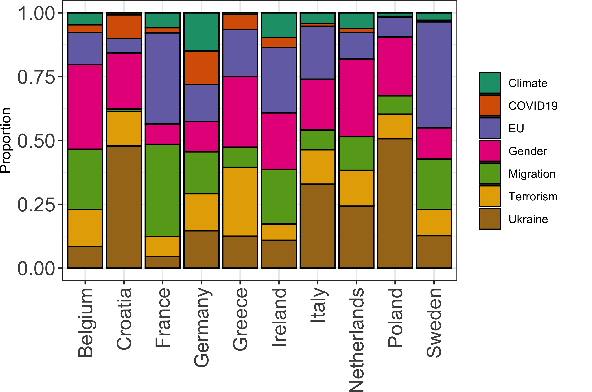
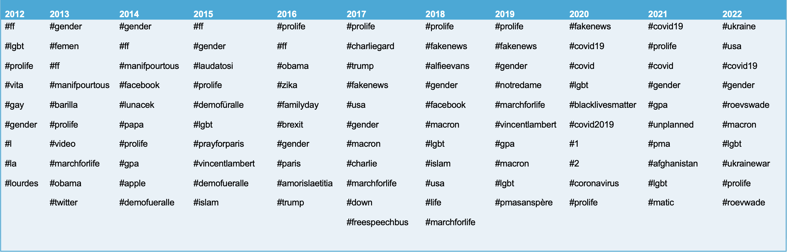
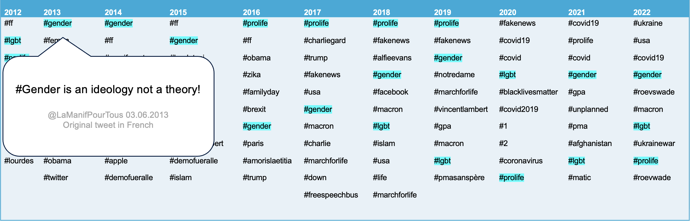
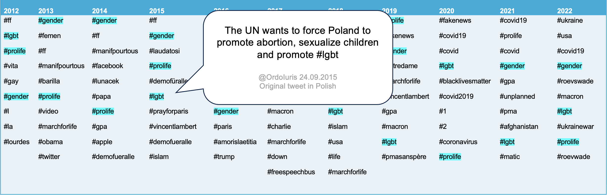
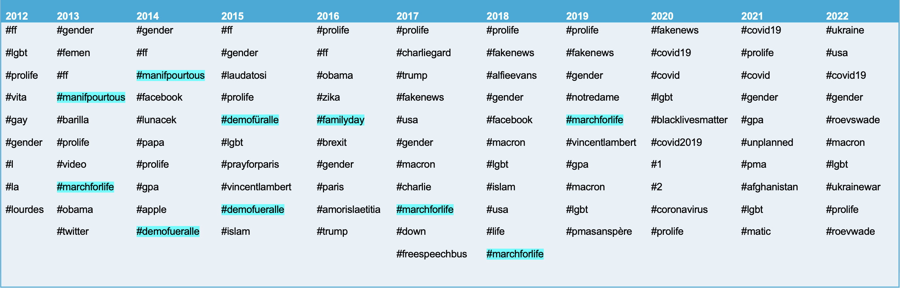
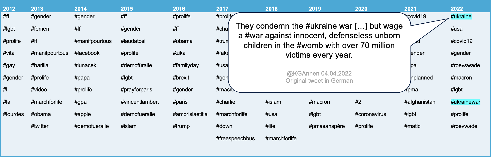
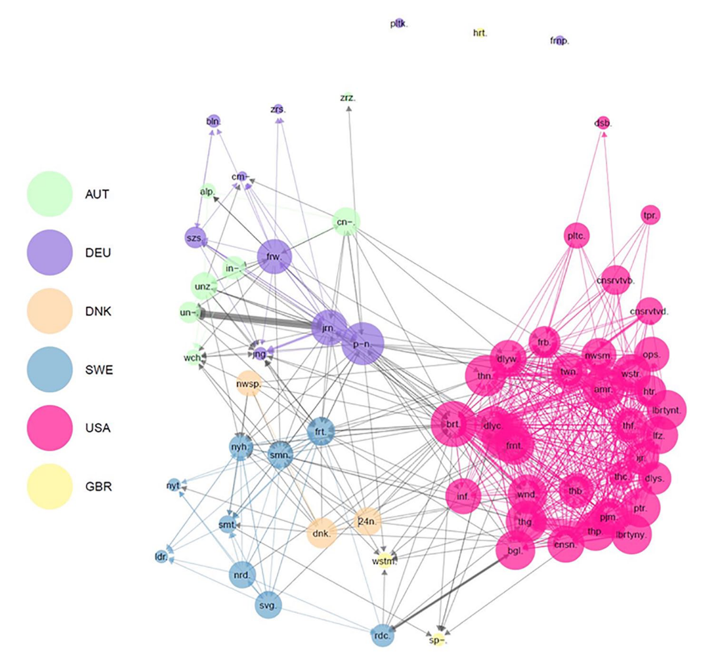

## 
<!-- {background-color="darkred"}  -->
<!-- #dc2223 -->

::: {style="text-align: center; color:white; font-size:45px; margin-top: 100px;"}
*__discourses__* frame issues, providing basis for connection and mobilisation of collective action 

::: 

::: {.fragment style="text-align: center; color:white; font-size:45px;"}
*__protest__* is a prominent method of attempting to set political agendas and advance (movement) goals 

::: 

::: {.fragment style="text-align: center; color:white; font-size:45px;"}
*__violence__* is a common outgrowth of extremist discourse and collective action---presenting a challenge to societies and a public policy concern for state actors

:::

## Complications of monitoring RWE  

- fuzzy boundaries of 'extremism' 
- different degrees of activity in different contexts---but also different national reporting and monitoring standards 
    + e.g., [RTV](https://www.sv.uio.no/c-rex/english/resources/rtv-dataset/) difficulty tracking violence beyond Western Europe; [OSCE hate crime](https://hatecrime.osce.org/) monitoring 
- sensitivities about historical memory issues, involvement/complicity of political parties, timing of monitoring and public communication thereof 

## Purpose of the presentation {visibility="hidden"}

- introduce some recent/current and/or larger projects monitoring RWE discourse, protest, and violence 
    + link these three phenomena, drawing on scholarly literature 
- put some data at your fingertips 
- discuss some recurring issues in policy and policymaking of RWE monitoring (and interventions)

## outline {visibility="hidden"}

OUTLINE (15-20 minutes): 

- Discourses [@ahmed2021UnitingFarRight; @bailard2024KeepYourHeads; @Giugni2005; @JohnsonETAL2019; @kasimov2023DecentralizedHateSustained; @vicenova2020RoleDigitalMedia; @volker2024DiscourseNetworksFar]
    + common topics: climate politics, COVID-19, EU, gender, migration, (Islamist) terrorism, Ukraine  
        * conspiracy beliefs: Great Replacement 
    + Transnational connections (Heft et al.)
    + Facebook discourse data? 
    + RWE demos in Germany data - quick text analysis of Mottos 
        * term frequency bars 
        * td-idf network (nodes coloured by organiser: NPD/Heimat, Rechte, III. Weg, ProChemnitz; other as grey) 
            
- Demonstrations [@castelligattinara2024WhenFarRight; @rocchetti2025DynamicsProtestsCounterprotests; @Virchow2007a; @vullers2022DoesCountermobilizationContain; @Weisskircher2019]
    + PolDem/ACLED overview? 
        * issue_xeno (Yes=1)
        * actor_party_right (Yes=1) [compare with actor_party_left]
    + FRGB on UK, FARPO on Italy  
        * year-month bar plot 
        * ggiraph by region/Kreis
        * mapview 
    + RWE demos in Germany data  
        * year-month bar plot 
        * ggiraph by region/Kreis
        * mapview

- Violence [@bjorgo2020WhyNordicResistance; @dasilva2022StreetSoldiersPolitical; @dejuan2025RightWingTerrorMedia; @JostETAL2025; @koopmans1996ExplainingRiseRacist; @krause2023DoesRightWingViolence; @Meadowcroft2017; @Ravndal2018; @whittington2024FarRightExtremismElections]
    + OSCE hate crime data 
        * notes about difficulties of comparing 'hate crimes' across country contexts 
    + RTV - lethal violence 

- Summarising/Diagnosing the problem(s) 


# RWE Discourse {background-color="#BD93F9"}

::: {style="margin-top: -40px;"} 

- large overlap between different '**far-right**' discources [@ahmed2021UnitingFarRight] 
    + broadly, RW 'extremism' *rejects democratic principles*

::: {.fragment .fade-up style="margin-top: -45px;"} 
- (online) discourses motivate (offline) activity and violence [@bailard2024KeepYourHeads;  @Giugni2005; @JohnsonETAL2019; @kasimov2023DecentralizedHateSustained]

::: {style="margin-top: -50px;"} 

> intensifying expressions of grievances online predict participation in offline violence [@bailard2024KeepYourHeads]

:::

:::

::: {.fragment .fade-up style="margin-top: -35px;"} 
- discursive activity can also contribute to normalising radical/extreme actors in politics and public life [@volker2024DiscourseNetworksFar]

:::

::: 

<!-- - Discourses [@ahmed2021UnitingFarRight; @bailard2024KeepYourHeads; @Giugni2005; @JohnsonETAL2019; @kasimov2023DecentralizedHateSustained; @vicenova2020RoleDigitalMedia; @volker2024DiscourseNetworksFar] -->
<!--     + common topics: climate politics, COVID-19, EU, gender, migration, (Islamist) terrorism, Ukraine   -->
<!--         * conspiracy beliefs: Great Replacement  -->
<!--     + Transnational connections (Heft et al.; Tronina) -->
<!--     + Facebook discourse data?  -->
<!--     + RWE demos in Germany data - quick text analysis of Mottos  -->
<!--         * term frequency bars  -->
<!--         * td-idf network (nodes coloured by organiser: NPD/Heimat, Rechte, III. Weg, ProChemnitz; other as grey)  -->

<!-- :::: {.columns} -->
<!-- :::{.column width="60%"} -->
<!-- - large overlap between different '**far-right**' discources [@ahmed2021UnitingFarRight]  -->
<!--     + broadly, right-wing 'extremist' actors *reject democratic principles* -->
<!-- - (online) discourses motivate (offline) activity and violence [@bailard2024KeepYourHeads;  @Giugni2005; @JohnsonETAL2019; @kasimov2023DecentralizedHateSustained] -->

<!-- > intensifying expressions of grievances online predict participation in offline violence [@bailard2024KeepYourHeads] -->

<!-- - discursive activity can also contribute to normalising radical/extreme actors in politics and public life [@volker2024DiscourseNetworksFar] -->

<!-- ::: -->

<!-- ::: {.column width="40%" .right} -->

<!-- <div class="tenor-gif-embed" data-postid="7015717914377444339" data-share-method="host" data-aspect-ratio="1.31746" data-width="100%"><a href="https://tenor.com/view/discourse-alarm-discourse-alarm-debate-gif-7015717914377444339">Discourse Alarm GIF</a>from <a href="https://tenor.com/search/discourse-gifs">Discourse GIFs</a></div> <script type="text/javascript" async src="https://tenor.com/embed.js"></script> -->

<!-- ::: -->
<!-- :::: -->

## Common topics across contexts 

<!--     + common topics: climate politics, COVID-19, EU, gender, migration, (Islamist) terrorism, Ukraine   -->
<!--         * conspiracy beliefs: Great Replacement  -->

- constantly shifting, but in recent years frequently: 

::: {.fragment .fade-up style="margin-top: -45px;"} 
[climate]{style="color:#1B9E77;"}, [COVID-19]{style="color:#D95F02;"}, [EU]{style="color:#7570B3;"}, [gender]{style="color:#E7298A;"}, [migration]{style="color:#66A61E;"}, [terrorism]{style="color:#E6AB02;"}, [Ukraine]{style="color:#A6761D;"}

:::

::: {.fragment .fade-up style="margin-top: -20px;"} 
{width=650}

:::

## Gender in focus [@tronina2026TransnationalizationAntiGenderPolitics] 

- common *discourses* can drive activism in different contexts 

- transnational set of SMOs campaigning against 'gender', for example:
    + framing it in opposition to 'family' 
    + likening **gender** and **LGBT** to 'profanity' and 'propaganda' 
- investigating this activity through Twitter/X accounts of SMOs in [Croatia (9)]{style="color:forestgreen;"}, [Germany (26)]{style="color:darkorange;"}, [France (41)]{style="color:goldenrod;"}, [Italy (43)]{style="color:violet;"}, and [Poland (29)]{style="color:cadetblue;"}

## Gender in focus [@tronina2026TransnationalizationAntiGenderPolitics] 

Most Transnationally Connective Hashtags Per Year 



## Gender in focus [@tronina2026TransnationalizationAntiGenderPolitics] 

Most Transnationally Connective Hashtags Per Year 

*[Dissemination]{style="color:cadetblue;"}* - getting the word out 



## Gender in focus [@tronina2026TransnationalizationAntiGenderPolitics] 

Most Transnationally Connective Hashtags Per Year 

*[Dissemination]{style="color:cadetblue;"}* - getting the word out 




## Gender in focus [@tronina2026TransnationalizationAntiGenderPolitics] 

Most Transnationally Connective Hashtags Per Year 

*[Mobilisation]{style="color:cadetblue;"}* 



## Gender in focus [@tronina2026TransnationalizationAntiGenderPolitics] 

Most Transnationally Connective Hashtags Per Year 

*[Extension]{style="color:cadetblue;"}* - connecting to other issues 



## RWE news ecology [@heftTransnationalInformationEcology2021]

- 'alternative news' sites/channels spread RWE *discourses* 

- @heftTransnationalInformationEcology2021 look at hyperlinks shared by right-wing online news sites (in Austria, Germany, United States, United Kingdom, Denmark, Sweden) in 2018

## RWE news ecology [@heftTransnationalInformationEcology2021]

- 'alternative news' sites/channels spread RWE *discourses* 

:::: {.columns}
:::{.column width="50%"}

 <!-- {width=650} -->

:::

::: {.column width="50%" .center}

- degree of transnational linkages differ by context 
    <!-- + suggestive of strategic orientation -->

- DE: some orgs. focus mostly domestically; others mostly internationally 
- SE, US: most orgs., mostly **domestically** 
- UK, AT, DK: most orgs., mostly **internationally** 

:::
::::

## RWE protest mottos (DE) {.smaller}

```{r}
#| echo: false
#| message: false
#| warning: false
library(readxl)
library(dplyr)
library(lubridate)
library(ggplot2)
de_demos <- read_excel("demos_2005-2024sep_geo.xlsx")
de_demos$Jahr <- as.numeric(de_demos$Jahr)
N <- max(de_demos$Jahr) - min(de_demos$Jahr)
de_demos$Jahr <- lubridate::ymd(de_demos$Jahr, truncated = 2L)
de_demos$Datum <- as.Date(de_demos$Datum)

```

*discourses* connect to *offline activity*: slogans of German RWE protests, some (randomly selected) examples: 

```{r example-mottos, message=FALSE, warning=FALSE, echo=FALSE}
# library(gtranslate)
library(polyglotr)
set.seed(123) 

examples <- sample(de_demos$Motto, 10)

# examples_en <- gtranslate::translate(
#   examples,
#   from = "de",
#   to = "en"
# )

examples_en <- polyglotr::google_translate(
  examples,
  target_language = "en",
  source_language = "de"
)

```


::: {.fragment style="margin-top: -10px;"}
**[`r examples[1]`]{style="color:#E64B35;"}**    

*`r examples_en[1]`*  
:::

::: {.fragment style="margin-top: -10px;"}
**[`r examples[2]`]{style="color:#E64B35;"}**    

*`r examples_en[2]`*  
:::

::: {.fragment style="margin-top: -10px;"}
**[`r examples[7]`]{style="color:#E64B35;"}**    

*`r examples_en[7]`*  
:::

::: {.fragment style="margin-top: -10px;"}
**[`r examples[4]`]{style="color:#E64B35;"}**    

*`r examples_en[4]`*  
:::

::: {.fragment style="margin-top: -10px;"}
**[`r examples[5]`]{style="color:#E64B35;"}**    

*`r examples_en[5]`*  
:::

::: {.fragment style="margin-top: -10px;"}
**[`r examples[6]`]{style="color:#E64B35;"}**    

*`r examples_en[6]`*  
:::

## RWE protest mottos (DE)

::: {style="margin-top: -25px;"} 
discourses connect to offline activity, here: the most frequent words in German RWE protest slogans

::: 

::: {style="margin-top: -25px;"} 
**all terms**

:::

<!-- ::: {.fragment .fade-up style="margin-top: -20px;"} -->

```{r mottos_netz, message=FALSE, warning=FALSE, echo=FALSE}

library(dplyr)
library(stringr)
library(tidytext)
library(tidyr)
library(purrr)
library(proxy)
library(visNetwork)
library(tidyverse)
library(stopwords)
library(igraph)
library(tidygraph)
library(scales)
library(ggiraph)

de_mottos <- de_demos %>%
  mutate(
    demo_id = row_number(),
    Motto = str_squish(as.character(Motto)),
    Zuordnung = replace_na(as.character(Zuordnung), "Unbekannt")
  ) %>%
  filter(!is.na(Motto), Motto != "")

german_stopwords <- tibble(
  word = stopwords::stopwords("de", source = "snowball")
)

extra_stopwords <- tibble(
  word = c(
    "nein", "statt", "raus", "tag"
  )
)

word_counts <- de_mottos %>%
  select(demo_id, Motto) %>%
  unnest_tokens(word, Motto) %>%
  anti_join(german_stopwords, by = "word") %>%
  anti_join(extra_stopwords, by = "word") %>%
  filter(str_detect(word, "[[:alpha:]]")) %>%
  count(word, sort = TRUE)

top_words <- word_counts %>%
  slice_max(order_by = n, n = 35, with_ties = FALSE) %>%
  mutate(word = reorder(word, n))

# ggplot(top_words, aes(x = word, y = n)) +
#   geom_col(fill = "#377EB8", width = 0.8) +
#   coord_flip() +
#   labs(
#     # title = "Most frequent words in demonstration mottos",
#     # subtitle = "German stopwords removed",
#     x = NULL,
#     y = "Frequency"
#   ) +
#   theme_bw(base_size = 14) +
#   theme(
#     plot.title = element_text(face = "bold"),
#     # panel.grid.major.y = element_blank()
#   )

group1 <- c(
  "heimat", "deutschland", "deutschen",
  "deutsche", "sachsen", "heim"
)

group2 <- c(
  "freiheit", "zukunft", "frieden", "volk",
  "gemeinsam", "kinder", "sicherheit"
)

group3 <- c("überfremdung", "asylmissbrauch", "asylflut")

plot_mottos <- function(highlight_words) {

  top_words %>%
    mutate(
      highlight = if_else(
        as.character(word) %in% highlight_words,
        "Highlighted",
        "Other"
      )
    ) %>%
    ggplot(aes(x = word, y = n, fill = highlight)) +
    geom_col(width = 0.8) +
    coord_flip() +
    scale_fill_manual(
      values = c(
        "Other" = "#377EB8",
        "Highlighted" = "#E64B35"
      ),
      guide = "none"
    ) +
    labs(
      x = NULL,
      y = "Frequency"
    ) +
    theme_bw(base_size = 14) +
    theme(
      plot.title = element_text(face = "bold")
    )
}


plot_mottos_int <- function(highlight_words) {

  p <- top_words %>%
    mutate(
      highlight = if_else(
        as.character(word) %in% highlight_words,
        "Highlighted",
        "Other"
      ),
      tooltip = paste0(
        "Word: ", word,
        "\nFrequency: ", n
      )
    ) %>%
    ggplot(aes(
      x = word,
      y = n,
      fill = highlight,
      tooltip = tooltip,
      data_id = word
    )) +
    geom_col_interactive(width = 0.8) +
    coord_flip() +
    scale_fill_manual(
      values = c(
        "Other" = "#377EB8",
        "Highlighted" = "#E64B35"
      ),
      guide = "none"
    ) +
    labs(
      x = NULL,
      y = "Frequency"
    ) +
    theme_bw(base_size = 14) +
    theme(
      plot.title = element_text(face = "bold")
    )

  girafe(
    ggobj = p,
    options = list(
      opts_hover(
        css = "fill: green; stroke: green;"
      ),
      opts_tooltip(
        css = "background-color: white; color: black; padding: 8px;"
      )
    )
  )
}

# ##~~~~~~~~~~~~~~~~~~~~~~~~~~~~~~~~~~~
# ##~~~~~~~~~~~~~~~~~~~~~~~~~~~~~~~~~~~
# ##~~~~~~~~~~~~~~~~~~~~~~~~~~~~~~~~~~~
# ## NET
# motto_tokens <- de_mottos %>%
#   select(demo_id, Motto) %>%
#   unnest_tokens(word, Motto) %>%
#   anti_join(german_stopwords, by = "word") %>%
#   filter(str_detect(word, "[[:alpha:]]"))
# 
# # TF-IDF for each word in each demonstration
# motto_tfidf <- motto_tokens %>%
#   count(demo_id, word, name = "n") %>%
#   bind_tf_idf(
#     term = word,
#     document = demo_id,
#     n = n
#   )
# 
# tfidf_wide <- motto_tfidf %>%
#   select(demo_id, word, tf_idf) %>%
#   pivot_wider(
#     names_from = word,
#     values_from = tf_idf,
#     values_fill = 0
#   ) %>%
#   arrange(demo_id)
# 
# doc_ids <- tfidf_wide$demo_id
# 
# tfidf_matrix <- tfidf_wide %>%
#   select(-demo_id) %>%
#   as.matrix()
# 
# rownames(tfidf_matrix) <- as.character(doc_ids)
# 
# # L2-normalise each document vector
# row_norms <- sqrt(rowSums(tfidf_matrix^2))
# valid <- row_norms > 0
# 
# tfidf_matrix <- tfidf_matrix[valid, , drop = FALSE]
# doc_ids <- doc_ids[valid]
# row_norms <- row_norms[valid]
# 
# normalised_matrix <- sweep(
#   tfidf_matrix,
#   1,
#   row_norms,
#   "/"
# )
# 
# ## can take a bit of time to run
# similarity_matrix <- normalised_matrix %*%
#   t(normalised_matrix)
# 
# diag(similarity_matrix) <- 0
# 
# # Convert the similarity matrix to a long table
# similarity_long <- as.data.frame(
#   as.table(similarity_matrix),
#   stringsAsFactors = FALSE
# ) %>%
#   transmute(
#     from = as.integer(as.character(Var1)),
#     to = as.integer(as.character(Var2)),
#     similarity = Freq
#   ) %>%
#   filter(from != to)
# 
# # Parameters to tune
# min_similarity <- 0.20
# top_k <- 3
# 
# # Create unique candidate edges from the upper triangle
# similarity_long <- as.data.frame(
#   as.table(similarity_matrix),
#   stringsAsFactors = FALSE
# ) %>%
#   transmute(
#     from = as.integer(as.character(Var1)),
#     to = as.integer(as.character(Var2)),
#     similarity = as.numeric(Freq)
#   ) %>%
#   filter(from < to, similarity >= min_similarity)
# 
# # Select the top k strongest connections for each node
# selected_edges <- bind_rows(
#   similarity_long %>%
#     group_by(from) %>%
#     slice_max(similarity, n = top_k, with_ties = FALSE),
# 
#   similarity_long %>%
#     group_by(to) %>%
#     slice_max(similarity, n = top_k, with_ties = FALSE)
# ) %>%
#   distinct(from, to, .keep_all = TRUE) %>%
#   transmute(
#     from,
#     to,
#     similarity,
#     width = scales::rescale(
#       similarity,
#       to = c(1, 6),
#       from = range(similarity, na.rm = TRUE)
#     ),
#     title = paste0(
#       "Cosine similarity: ",
#       round(similarity, 3)
#     )
#   )
# 
# # Create node data
# network_nodes <- de_mottos %>%
#   filter(demo_id %in% doc_ids) %>%
#   transmute(
#     id = demo_id,
#     label = paste0(demo_id, ": ", str_trunc(Ort, 20)),
#     group = Zuordnung,
#     title = paste0(
#       "<b>Zuordnung:</b> ", Zuordnung,
#       "<br><b>Datum:</b> ", Datum,
#       "<br><b>Ort:</b> ", Ort,
#       "<br><b>Motto:</b> ", Motto
#     ),
#     Motto,
#     Ort,
#     Datum
#   )
# 
# # Assign consistent colours to Zuordnung categories
# category_colours <- scales::hue_pal()(n_distinct(network_nodes$group))
# 
# colour_map <- setNames(
#   category_colours,
#   unique(network_nodes$group)
# )
# 
# network_nodes <- network_nodes %>%
#   mutate(color = unname(colour_map[group]))
# 
# visNetwork(
#   nodes = network_nodes,
#   edges = selected_edges,
#   main = "Similarity network of demonstration mottos",
#   submain = "TF-IDF cosine similarity; nodes coloured by Zuordnung",
#   width = "100%",
#   height = "750px"
# ) %>%
#   visNodes(
#     shape = "dot",
#     size = 15,
#     font = list(size = 14)
#   ) %>%
#   visEdges(
#     smooth = FALSE,
#     color = list(
#       color = "#A0A0A0",
#       highlight = "#333333",
#       hover = "#333333"
#     ),
#     scaling = list(
#       min = 1,
#       max = 6
#     )
#   ) %>%
#   visOptions(
#     highlightNearest = list(
#       enabled = TRUE,
#       degree = 1,
#       hover = TRUE
#     ),
#     nodesIdSelection = TRUE
#   ) %>%
#   visInteraction(
#     hover = TRUE,
#     navigationButtons = TRUE,
#     keyboard = TRUE
#   ) %>%
#   visPhysics(
#     solver = "forceAtlas2Based",
#     forceAtlas2Based = list(
#       gravitationalConstant = -50,
#       springLength = 100,
#       springConstant = 0.08
#     ),
#     stabilization = list(
#       iterations = 200
#     )
#   ) %>%
#   visLegend(
#     useGroups = FALSE,
#     addNodes = data.frame(
#       label = names(colour_map),
#       color = unname(colour_map),
#       shape = "dot"
#     ),
#     position = "right"
#   )

## ~~~~~~~~~~~~~~~~~~~~~~~~~~~~~~~~~~~~~~~~~~~~~~~~~~~~~~~
## instead of treating each demonstration as a node, we can treat each unique Zuordnung as a node and compare the overall motto vocabulary associated with each category

# German stopwords
german_stopwords <- tibble(
  word = stopwords::stopwords("de", source = "snowball")
)

extra_stopwords <- tibble(
  word = c(
    "stands", "standing", "means", "meaning",
    "refers", "referring", "used", "use"
  )
)

## fix a couple inconsistencies 
de_demos <- de_demos %>%
  mutate(
    Zuordnung = case_when(
      Zuordnung == "Neonazis/Rechtsextremisten" ~ "Neonazis / Rechtsextremisten",
      Zuordnung == "NPD-JN"   ~ "NPD/JN",
      Zuordnung == "NPD"   ~ "NPD/JN",
      TRUE                   ~ Zuordnung
    )
  )

de_demos <- de_demos %>%
  filter(!Zuordnung %in% c("NeonazisX", "(ohne)"))

# One document per Zuordnung
category_docs <- de_demos %>%
  mutate(
    Zuordnung = replace_na(as.character(Zuordnung), "Unbekannt"),
    Motto = str_squish(as.character(Motto))
  ) %>%
  filter(!is.na(Motto), Motto != "") %>%
  group_by(Zuordnung) %>%
  summarise(
    Motto = paste(Motto, collapse = " "),
    n_demos = n(),
    .groups = "drop"
  ) %>%
  mutate(category_id = row_number())

## calculate TF-IDF for each category
category_tokens <- category_docs %>%
  select(category_id, Motto) %>%
  unnest_tokens(word, Motto) %>%
  anti_join(german_stopwords, by = "word") %>%
  anti_join(extra_stopwords, by = "word") %>%
  filter(str_detect(word, "[[:alpha:]]"))

category_tfidf <- category_tokens %>%
  count(category_id, word, name = "n") %>%
  bind_tf_idf(
    term = word,
    document = category_id,
    n = n
  )

# Create the category-term matrix
tfidf_wide <- category_tfidf %>%
  select(category_id, word, tf_idf) %>%
  pivot_wider(
    names_from = word,
    values_from = tf_idf,
    values_fill = 0
  )

# Include every category, even if it has no usable tokens
all_ids <- category_docs$category_id
vocabulary <- setdiff(names(tfidf_wide), "category_id")

tfidf_matrix <- matrix(
  0,
  nrow = length(all_ids),
  ncol = length(vocabulary),
  dimnames = list(as.character(all_ids), vocabulary)
)

if (nrow(tfidf_wide) > 0 && length(vocabulary) > 0) {
  tfidf_matrix[
    match(tfidf_wide$category_id, all_ids),
    vocabulary
  ] <- as.matrix(tfidf_wide[, vocabulary, drop = FALSE])
}

# Normalise rows to unit length
row_norms <- sqrt(rowSums(tfidf_matrix^2))
valid <- row_norms > 0

normalised_matrix <- tfidf_matrix
normalised_matrix[valid, ] <- sweep(
  tfidf_matrix[valid, , drop = FALSE],
  1,
  row_norms[valid],
  "/"
)

# Cosine similarity
similarity_matrix <- normalised_matrix %*% t(normalised_matrix)
diag(similarity_matrix) <- 0

min_similarity <- 0.05

similarity_long <- as.data.frame(
  as.table(similarity_matrix),
  stringsAsFactors = FALSE
) %>%
  transmute(
    from = as.integer(as.character(Var1)),
    to = as.integer(as.character(Var2)),
    similarity = as.numeric(Freq)
  ) %>%
  filter(
    from < to,
    similarity >= min_similarity
  ) %>%
  mutate(
    width = 0.5 + 15 * similarity,
    title = paste0(
      "Cosine similarity: ",
      round(similarity, 3)
    )
  )

# Manually define colours for each Zuordnung category
colour_map <- c(
  "NPD/JN" = "#E41A1C",
  "Neonazis / Rechtsextremisten"   = "#984EA3",
  "NPD/JN/Neonazis / Rechtsextremisten" = "red",
  "NPD/JN/DIE RECHTE" = "red",
  "pro NRW" = "#009233",
  "DIE RECHTE" = "#964B00",
  "Der III. Weg" = "forestgreen",
  "Neonazis / Rechtsextremisten/Der III. Weg" = "darkgreen",
  "NPD/JN – „Freie Kräfte“" = "#377EB8",
  "Parteien" = "#FF7F00"
)

# Prepare nodes, including size based on number of demonstrations
network_nodes <- category_docs %>%
  transmute(
    id = category_id,
    label = Zuordnung,
    group = Zuordnung,
    n_demos = n_demos,
    title = paste0(
      "<b>Zuordnung:</b> ",
      htmltools::htmlEscape(Zuordnung),
      "<br><b>Number of demonstrations:</b> ",
      n_demos
    ),
    color = unname(colour_map[Zuordnung]),
    size = scales::rescale(
      n_demos,
      to = c(10, 45)
    )
  ) %>%
  mutate(
    # Grey fallback for categories without an assigned colour
    color = coalesce(color, "#BDBDBD")
  )

# Build the network
ZuordnungNet <- visNetwork(
  nodes = network_nodes,
  edges = similarity_long,
  width = "100%",
  height = "500px"
) %>%
  visNodes(
    shape = "dot",
    font = list(size = 16)
  ) %>%
  visEdges(
    color = list(
      color = "#A0A0A0",
      highlight = "#333333",
      hover = "#333333"
    ),
    width = "width"
    # scaling = list(min = 1, max = 20)
  ) %>%
  visOptions(
    highlightNearest = list(
      enabled = TRUE,
      degree = 1,
      hover = TRUE
    )
  ) %>%
  visInteraction(
    hover = TRUE,
    navigationButtons = TRUE
  ) %>%
  visPhysics(
    solver = "forceAtlas2Based",
    forceAtlas2Based = list(
      gravitationalConstant = -50,
      springLength = 180,
      springConstant = 0.08
    ),
    stabilization = list(iterations = 200)
  )

# ZuordnungNet

##~~~~~~~~~~~~~~~~~~~~~~~~~~~~~~~~~~~~~~~~~~~~~~~~~~~~
## STATIC PLOT VERSION 
# Prepare vertices
nodes <- category_docs %>%
  transmute(
    name = as.character(category_id),
    label = Zuordnung,
    n_demos = n_demos,
    color = coalesce(
      unname(colour_map[Zuordnung]),
      "#BDBDBD"
    ),
    size = rescale(n_demos, to = c(10, 45))
  )

edges <- similarity_long %>%
  transmute(
    from = as.character(from),
    to = as.character(to),
    weight = width
  )

g <- graph_from_data_frame(
  d = edges,
  directed = FALSE,
  vertices = nodes
)

##node and edge attributes
V(g)$color <- nodes$color[
  match(V(g)$name, nodes$name)
]

V(g)$label <- nodes$label[
  match(V(g)$name, nodes$name)
]

V(g)$size <- nodes$size[
  match(V(g)$name, nodes$name)
]

V(g)$label.cex <- 1.4
V(g)$label.color <- "black"
V(g)$frame.color <- "white"

E(g)$color <- "#A0A0A0"
E(g)$width <- rescale(
  E(g)$weight,
  to = c(0.5, 5)
)

# Calculate a static force-directed layout
set.seed(123)
layout <- layout_with_fr(
  g,
  weights = E(g)$weight,
  niter = 1000
)

```

```{r mottos_highlight, message=FALSE, warning=FALSE, echo=FALSE}
plot_mottos_int(character(0))
```

<!-- :::  -->


## RWE protest mottos (DE)

::: {style="margin-top: -25px;"} 
discourses connect to offline activity, here: the most frequent words in German RWE protest slogans

:::

::: {style="margin-top: -25px;"} 
**National identity**

:::

```{r mottos_highlight1, message=FALSE, warning=FALSE, echo=FALSE}
plot_mottos_int(group1)
```

## RWE protest mottos (DE)

::: {style="margin-top: -25px;"} 
discourses connect to offline activity, here: the most frequent words in German RWE protest slogans

:::

::: {style="margin-top: -25px;"} 
**Aspirations and community**

:::

```{r mottos_highlight2, message=FALSE, warning=FALSE, echo=FALSE}
plot_mottos_int(group2)
```

## RWE protest mottos (DE)

::: {style="margin-top: -25px;"} 
discourses connect to offline activity, here: the most frequent words in German RWE protest slogans

::: 

::: {style="margin-top: -25px;"} 
**Anti-migration**

:::

```{r mottos_highlight3, message=FALSE, warning=FALSE, echo=FALSE}
plot_mottos_int(group3)
```


## RWE protest mottos (DE) {background-color="white"}


```{r mottos_netz2, message=FALSE, warning=FALSE, echo=FALSE, fig.width=12, fig.height=10, out.width="100%"}
# ZuordnungNet

par(mar = c(0, 0, 0, 0), oma = c(0, 0, 0, 0))

# lay <- layout_randomly(g)
lay <- layout_in_circle(g)

# Magnify the network coordinates
lay <- lay * 1.5

plot(
  g,
  layout = lay, # layout.circle, # layout, layout.random
  vertex.shape = "circle",
  vertex.label = V(g)$label,
  vertex.label.family = "sans",
  vertex.label.cex = V(g)$label.cex,
  vertex.label.dist = 0 #,
  # edge.curved = 0
)

``` 


<!-- ::: {.fragment .absolute top=100 left=10} -->
<!-- - patterns and  -->

<!-- :::  -->

::: {.absolute top=100 left=600}
- nodes: RWE demonstration categories as tracked by German governments 
- edges: indicate strength of similarity of terms in demo. groups' 'motto' texts 

::: 

# RWE Protest {background-color="#BD93F9"}

<!-- :::: {.columns} -->
<!-- :::{.column width="60%"} -->

::: {style="margin-top: -50px;"} 
- demonstrations serve many purposes for RWE: building *solidarity/collective identity* [@Virchow2007a; @Meadowcroft2017], attracting *media attention* [@castelligattinara2024WhenFarRight], <!-- structuring activism,  -->recurrent dates for *networking* [@Zeller2026CUP], *agenda setting* and building momentum for far-right parties [@Weisskircher2019]
<!-- ]{style="font-size:24px;"} -->

:::

::: {.fragment .fade-up style="margin-top: -50px;"} 
- *countermobilisation* often emerges to oppose RWE protest---with mixed results [@vullers2022DoesCountermobilizationContain; @rocchetti2025DynamicsProtestsCounterprotests; @Zeller2021_hess; @Zeller2025ejpr]

::: 

::: {.fragment .fade-up style="margin-top: -50px;"} 
- several projects track RWE protest activity 
    + some comparative: [Poldem](https://poldem.eui.eu/)<!-- (Observatory for Political Conflict and Democracy in Europe) -->; [ACLED](https://acleddata.com/)<!-- (Armed Conflict Location and Event Data) -->; myriad country-specific projects 

:::

<!-- ::: {.callout-note collapse="true" style="margin-top: -25px;"} -->
<!-- ### Data file (CSV) [Download the data](poldem/poldem-protest_30.csv) -->

<!-- ::: -->


<!-- ::: {.callout-note collapse="true" style="margin-top: -25px;"} -->
<!-- ### Data file (Excel) [Download the data](poldem-protest_30.csv) -->

<!-- ::: -->

<!-- - Demonstrations [@castelligattinara2024WhenFarRight; @rocchetti2025DynamicsProtestsCounterprotests; @Virchow2007a; @vullers2022DoesCountermobilizationContain; @Weisskircher2019] -->
<!--     + PolDem/ACLED overview?  -->
<!--         * issue_xeno (Yes=1) -->
<!--         * actor_party_right (Yes=1) [compare with actor_party_left] -->
<!--     + FRGB on UK, FARPO on Italy   -->
<!--         * year-month bar plot  -->
<!--         * ggiraph by region/Kreis -->
<!--         * mapview  -->
<!--     + RWE demos in Germany data   -->
<!--         * year-month bar plot  -->
<!--         * ggiraph by region/Kreis -->
<!--         * mapview -->

<!-- ::: -->

<!-- ::: {.column width="40%" .right} -->

<!-- <div class="tenor-gif-embed" data-postid="19439147" data-share-method="host" data-aspect-ratio="1" data-width="100%"><a href="https://tenor.com/view/are-we-protesting-or-are-we-rioting-south-park-pandemic-special-s24e1-s24e2-gif-19439147">Are We Protesting Or Are We Rioting South Park GIF</a>from <a href="https://tenor.com/search/are+we+protesting+or+are+we+rioting-gifs">Are We Protesting Or Are We Rioting GIFs</a></div> <script type="text/javascript" async src="https://tenor.com/embed.js"></script> -->

<!-- ::: -->
<!-- :::: -->

## RWE Protest - overview {background-color="white"}

<!-- *make interactive with xts?* -->

<!-- PolDem: stacked bars (country) over time of xenophobic protest - issue_xeno (Yes=1) -->

```{r poldem, message=FALSE, warning=FALSE, echo=FALSE}
poldem <- read.csv("poldem/poldem-protest_30.csv")
poldem$date <- as.Date(poldem$date)


# poldem %>%
#   filter(issue_xeno == "yes") %>%
#   count(year, month) %>%
#   mutate(date = as.Date(sprintf("%d-%02d-01", year, month))) %>%
#   ggplot(aes(x = date, y = n)) +
#   geom_col(fill = "#E64B35") +
#   labs(
#     # title = "Issue_xeno demos over time",
#     x = "Year-Months",
#     y = "Number of protests"
#   ) +
#   scale_x_date(date_labels = "%Y", date_breaks = "1 years") +
#   theme_bw(base_size = 17)+
#   theme(axis.text.x=element_text(angle=90, hjust=1, vjust=0.5))

library(dygraphs)
library(xts)

protests_monthly <- poldem %>%
  filter(issue_xeno == "yes") %>%
  count(year, month) %>%
  mutate(
    date = as.Date(sprintf("%d-%02d-01", year, month))
  ) %>%
  arrange(date) %>%
  select(date, n)

protests_xts <- xts(
  protests_monthly$n,
  order.by = protests_monthly$date
)

colnames(protests_xts) <- "Number of protests"

dygraph(
  protests_xts # , main = "Issue_xeno protests over time"
) %>%
dyOptions(
  colors = "#E64B35",
  drawPoints = TRUE,
  pointSize = 3,
  axisLabelFontSize = 22,
  axisLabelWidth = 60
) %>%
dyBarChart() %>%
  dyAxis(
    "x",
    label = "Year-Month",
    axisLabelFontSize = 22
  ) %>%
  dyAxis(
    "y",
    label = "Number of protests",
    axisLabelFontSize = 22
  ) %>%
  dyRangeSelector() %>%
  dyCrosshair(
    direction = "vertical"
  )
```

[PolDem](https://poldem.eui.eu/) - xenophobic protests 2000-2015

## RWE Protest - overview

```{r poldem_party, message=FALSE, warning=FALSE, echo=FALSE}

# poldem %>%
#   filter(issue_xeno == "yes") %>%
#   mutate(
#     party_right = if_else(
#       actor_party_right == "yes",
#       "RW Party participation",
#       "No party participation"
#     )
#   ) %>%
#   count(year, party_right) %>%
#   ggplot(aes(x = year, y = n, fill = party_right)) +
#   geom_col() +
#   scale_fill_manual(
#     values = c(
#       "RW Party participation" = "#E64B35",
#       "No party participation" = "#377EB8"
#     )
#   ) +
#   labs(
#     # title = "Xenophobic protests by year and party association",
#     x = "",
#     y = "Number of protests",
#     fill = "" # "Party participation"
#   ) +
#   scale_x_continuous(breaks=seq(2000,2015,1),minor_breaks=seq(2000,2015,1))+
#   theme_bw(base_size = 18)+
#   theme(axis.text.x=element_text(angle=90, hjust=1, vjust=0.5),
#         legend.position = "bottom")

p <- poldem %>%
  filter(issue_xeno == "yes") %>%
  mutate(
    party_right = if_else(
      actor_party_right == "yes",
      "RW Party participation",
      "No party participation"
    )
  ) %>%
  count(year, party_right) %>%
  mutate(
    tooltip = paste0(
      "Year: ", year,
      "\nParty participation: ", party_right,
      "\nNumber of protests: ", n
    )
  ) %>%
  ggplot(aes(
    x = year,
    y = n,
    fill = party_right,
    tooltip = tooltip,
    data_id = interaction(year, party_right)
  )) +
  geom_col_interactive() +
  scale_fill_manual(
    values = c(
      "RW Party participation" = "#E64B35",
      "No party participation" = "#377EB8"
    )
  ) +
  labs(
    x = "",
    y = "Number of protests",
    fill = ""
  ) +
  scale_x_continuous(
    breaks = seq(2000, 2015, 1),
    minor_breaks = seq(2000, 2015, 1)
  ) +
  theme_bw(base_size = 18) +
  theme(
    axis.text.x = element_text(
      angle = 90,
      hjust = 1,
      vjust = 0.5
    ),
    legend.position = "bottom"
  )

girafe(
  ggobj = p,
  options = list(
    opts_hover(css = "fill: green;"),
    opts_tooltip(
      css = "background-color: white; color: black; padding: 8px;"
    )
  )
)
```

[PolDem](https://poldem.eui.eu/) - xeno. protests 2000-2015, party participation

<!-- - PolDem: actor_party_right (Yes=1)  -->

## RWE Protest - overview

```{r poldem_map, message=FALSE, warning=FALSE, echo=FALSE}
library(ggplot2)
library(ggiraph)
library(sf)
library(rnaturalearth)

xeno_counts <- poldem %>%
  filter(issue_xeno == "yes") %>%
  count(country_name, name = "n_xeno")

europe <- ne_countries(
  continent = "Europe",
  returnclass = "sf"
)

country_lookup <- c(
   "austria"         ="Austria"         ,
   "belgium"         ="Belgium"         ,
   "bulgaria"        ="Bulgaria"        ,
   "cyprus"          ="Cyprus"          ,
   "czech republic"  ="Czechia"         ,
   "denmark"         ="Denmark"         ,
   "estonia"         ="Estonia"         ,
   "finland"         ="Finland"         ,
   "france"          ="France"          ,
   "germany"         ="Germany"         ,
   "greece"          ="Greece"          ,
   "hungary"         ="Hungary"         ,
   "ireland"         ="Ireland"         ,
   "italy"           ="Italy"           ,
   "latvia"          ="Latvia"          ,
   "lithuania"       ="Lithuania"       ,
   "netherlands"     ="Netherlands"     ,
   # "northern ireland"="Northern Ireland",
   "norway"          ="Norway"          ,
   "poland"          ="Poland"          ,
   "portugal"        ="Portugal"        ,
   "romania"         ="Romania"         ,
   "slovakia"        ="Slovakia"        ,
   "slovenia"        ="Slovenia"        ,
   "spain"           ="Spain"           ,
   "sweden"          ="Sweden"          ,
   "switzerland"     ="Switzerland"     ,
   "united kingdom"  ="United Kingdom"  
)

xeno_counts <- xeno_counts %>%
  mutate(
    map_country = unname(country_lookup[country_name])
  )

europe_xeno <- europe %>%
  left_join(
    xeno_counts,
    by = c("name" = "map_country")
  ) %>%
  mutate(
    tooltip_text = if_else(
      is.na(n_xeno),
      paste0(name, "\nNo data available"),
      paste0(name, "\nXenophobic protests: ", n_xeno)
    )
  )

## missing from join (Cyprus, N. Ireland)
# anti_join(
#   xeno_counts,
#   st_drop_geometry(europe) %>%
#     distinct(name),
#   by = c("map_country" = "name")
# )

p <- ggplot(europe_xeno) +
  geom_sf_interactive(
    aes(
      fill = n_xeno,
      tooltip = tooltip_text,
      data_id = name
    ),
    colour = "white",
    linewidth = 0.3,
    hover_css = "fill: red; stroke: black; stroke-width: 1.5px;"
  ) +
  scale_fill_viridis_c(
    option = "C",
    name = "Protests",
    labels = scales::label_comma(),
    na.value = "grey80"
  )+
  coord_sf(
    xlim = c(-12, 35),
    ylim = c(34, 72),
    expand = FALSE
  ) +
  labs(
    # title = "Xenophobic protests, 2000-2015",
    # subtitle = "Hover over a country to see the number of protests"
  ) +
  theme_void(base_size = 13) +
  theme(
    axis.title = element_blank(),
    panel.grid = element_blank()
  )

girafe(ggobj = p)
```

[PolDem](https://poldem.eui.eu/) - xenophobic protests 2000-2015


## RWE protest (Germany) {visibility="hidden"} 
<!-- {auto-animate="true"} -->

- Identified in gov. responses to parliamentary inquiries <!-- (*Anfrage*) -->

```{r}
#| echo: true
#| message: false
#| warning: false

de_demos

```

## RWE protest (Germany) {visibility="hidden"} 
<!-- {auto-animate="true"} -->

- Identified in gov. responses to parliamentary inquiries <!-- (*Anfrage*) -->

```{r}
#| echo: true
#| fig-width: 18
#| fig-height: 6
de_demos %>% 
  mutate(month=floor_date(Datum, "month")) %>% 
  group_by(month) %>% summarise(Num=n())
```

## RWE protest (Germany) {visibility="hidden"} 
<!-- {auto-animate="true"} -->

- Identified in gov. responses to parliamentary inquiries <!-- (*Anfrage*) -->

```{r}
#| echo: true
#| fig-width: 18
#| fig-height: 6
de_demos %>% 
  mutate(month=floor_date(Datum, "month")) %>% 
  group_by(month) %>% summarise(Num=n()) %>% 
  ggplot(aes(x=month, y=Num))+ geom_bar(stat="identity")
```

## RWE protest (Germany) {visibility="hidden"} 

```{r}
#| echo: false
#| message: false
#| warning: false
#| fig-width: 18
#| fig-height: 6
de_demos %>% 
  mutate(month=floor_date(Datum, "month")) %>% 
  group_by(month) %>% summarise(Num=n()) %>% 
  ggplot(aes(x=month, y=Num))+ # geom_bar(stat="identity")+
  geom_col(fill = "#E64B35") +
  scale_x_date("", labels=scales::date_format("%b %Y"), breaks="6 month",
            limits=c(min(as.Date(de_demos$Datum)),max(as.Date(de_demos$Datum))),expand=c(0,0))+
  theme_bw()+ylab("")+
  theme(text=element_text(size=38),
        axis.text.x=element_text(angle=90, hjust=1, vjust=0.5))
```

<!-- ::: {.callout-note collapse="true" style="margin-top: -15px;"} -->

<!-- ### Data file (Excel) [Download the data](demos_2005-2024sep_geo.xlsx) -->

<!-- ::: -->

## RWE protest (Germany, Italy, UK)

::: {.absolute top="180" right="80"}
**[Italy]{style="color:#FF6347; font-size:45px;"}**  
**[UK]{style="color:#4682B4; font-size:45px;"}**  
**[Germany]{style="color:#32CD32; font-size:45px;"}** 
:::

```{ojs}
//| echo: false
// Combine the datasets 

Italy = [
  {Year: 2008, Num: 42}, {Year: 2009, Num: 117}, {Year: 2010, Num: 269},
  {Year: 2011, Num: 233}, {Year: 2012, Num: 196}, {Year: 2013, Num: 225},
  {Year: 2014, Num: 228}, {Year: 2015, Num: 190}, {Year: 2016, Num: 138},
  {Year: 2017, Num: 54}, {Year: 2018, Num: 26}
]

UK = [
  {Year: 2009, Num: 40}, {Year: 2010, Num: 98}, {Year: 2011, Num: 148},
  {Year: 2012, Num: 116}, {Year: 2013, Num: 161}, {Year: 2014, Num: 149},
  {Year: 2015, Num: 123}, {Year: 2016, Num: 83}, {Year: 2017, Num: 84},
  {Year: 2018, Num: 107}, {Year: 2019, Num: 107}
]

Germany = [
  {Year: 2005, Num: 187}, {Year: 2006, Num: 151}, {Year: 2007, Num: 129},
  {Year: 2008, Num: 103}, {Year: 2009, Num: 137}, {Year: 2010, Num: 85},
  {Year: 2011, Num: 142}, {Year: 2012, Num: 132}, {Year: 2013, Num: 186},
  {Year: 2014, Num: 219}, {Year: 2015, Num: 491}, {Year: 2016, Num: 330},
  {Year: 2017, Num: 107}, {Year: 2018, Num: 129}, {Year: 2019, Num: 174},
  {Year: 2020, Num: 151}, {Year: 2021, Num: 89}, {Year: 2022, Num: 143},
  {Year: 2023, Num: 196}, {Year: 2024, Num: 170}
]

// Create a dropdown which dataset to display (Inputs.select) - Inputs.radio for radio buttons
// FIRST VERSION: viewof dataset = Inputs.radio(["IT (farpo)", "UnitedKingdom (frgb)", "DE (bt)"], {label: "Dataset"})
viewof datasets = Inputs.checkbox(
  ["IT (farpo)", "UK (frgb)", "DE (bt)"], 
  {label: "", value: ["IT (farpo)", "UK (frgb)", "DE (bt)"]}
)


// Choose the corresponding dataset based on the selection
// FIRST VERSION: selected_data = dataset === "IT (farpo)" ? Italy : dataset === "UK (frgb)" ? UK : Germany
// Combine the selected datasets into one array
selected_data = datasets.flatMap(dataset => {
  if (dataset === "IT (farpo)") {
    return Italy.map(d => ({...d, dataset: "Italy"}));
  } else if (dataset === "UK (frgb)") {
    return UK.map(d => ({...d, dataset: "UK"}));
  } else if (dataset === "DE (bt)") {
    return Germany.map(d => ({...d, dataset: "Germany"}));
  }
  return [];
});

```

```{ojs}
//| echo: false

// plot as a bar plot
// FIRST VERSION: Plot.plot({
//   x: {
//     label: "", tickSize: 2, tickRotate: -45,
//     tickFormat: d => d.toString() // Converts the year to a string to avoid number formatting
//   },
//   y: {
//     grid: true
//   },
//   margin: 100,
//   marks: [
//     Plot.barY(selected_data, {x: "Year", y: "Num", fill: "darkred"})
//   ],
//   width: 1200,
//   height: 600,
//   style: {
//     fontSize: 30,
//   },
// })

// plot as a bar plot with dodged bars colored by dataset
Plot.plot({
  width: 1200,
  height: 600,

  marginTop: 30,
  marginRight: 100,
  marginBottom: 110,
  marginLeft: 100,

  style: {
    fontSize: "20px",
    color: "black",
    background: "white"
  },

  x: {
    label: null,
    tickSize: 6,
    tickRotate: -45,
    tickFormat: d => d.toString(),
    tickPadding: 8,
    color: "black",
    line: true
  },

  y: {
    label: "Number",
    grid: true,
    color: "black",
    tickSize: 6,
    tickPadding: 8,
    line: true
  },

  color: {
    legend: true,
    domain: ["Italy", "UK", "Germany"],
    range: ["#FF6347", "#4682B4", "#32CD32"]
  },

  marks: [
    Plot.ruleY([0], {
      stroke: "black",
      strokeWidth: 1
    }),

    Plot.barY(selected_data, {
      x: "Year",
      y: "Num",
      fill: "dataset"
    })
  ]
})

```

## RWE protest (Germany, 2005-2024) 

<!-- mapview with toggles by year  -->

```{r germany, message=FALSE, warning=FALSE, echo=FALSE}

library(tidyverse)
library(sf)
library(rnaturalearth)
library(mapview)
library(leafpop)

de_demos$Jahr <- format(as.Date(de_demos$Jahr), format = "%Y")

de_demos_grouped <- de_demos %>% 
  group_by(Ort, Jahr, lat, long) %>%
  summarise(protests = n(),
            .groups = "drop")

de_demos_grouped <- as.data.frame(de_demos_grouped)

de_demos_grouped$Latitude <- de_demos_grouped$lat
de_demos_grouped$Longitude <- de_demos_grouped$long

de_demos_grouped_sf <- de_demos_grouped %>% drop_na(lat)

de_demos_grouped_sf <- de_demos_grouped_sf %>% 
  st_as_sf(
    coords = c("long", "lat"),
    crs = st_crs("EPSG:32632") # CRS for Germany
  )

DE = ne_states(returnclass = "sf") |>
  filter(admin == "Germany") 

st_crs(de_demos_grouped_sf) <- st_crs(DE)


years <- sort(unique(de_demos_grouped_sf$Jahr))

year_layers <- lapply(years, function(yr) {
  sub <- de_demos_grouped_sf[de_demos_grouped_sf$Jahr == yr, ]
  point_sizes <- 5 + 7 * (
    (sub$protests - min(sub$protests, na.rm = TRUE)) /
    (max(sub$protests, na.rm = TRUE) - min(sub$protests, na.rm = TRUE))
  )
  mapview(
    sub,
    cex = point_sizes,
    # zcol = "side",
    col.regions = c("#32CD32"),
    # col.regions = c("pro-pegida" = "#b2182b", "anti-pegida" = "#2166ac"),
    map.types = c("OpenStreetMap"),
    popup = popupTable(
      sub,
      zcol = c("Ort", "Jahr", "protests")
    ),
    layer.name = paste("RWE demos", yr)
  )
})

Reduce(`+`, year_layers)

# # Generate one distinct color per year
# year_colors <- setNames(
#   grDevices::hcl.colors(length(years), palette = "Dark 3"),
#   years
# )
# 
# year_layers <- lapply(years, function(yr) {
#   sub <- de_demos_grouped_sf[de_demos_grouped_sf$Jahr == yr, ]
# 
#   point_sizes <- 5 + 7 * (
#     (sub$protests - min(sub$protests, na.rm = TRUE)) /
#     (max(sub$protests, na.rm = TRUE) - min(sub$protests, na.rm = TRUE))
#   )
# 
#   mapview(
#     sub,
#     cex = point_sizes,
#     col.regions = year_colors[as.character(yr)],
#     color = year_colors[as.character(yr)],
#     map.types = "OpenStreetMap",
#     popup = popupTable(
#       sub,
#       zcol = c("Ort", "Jahr", "protests")
#     ),
#     layer.name = paste("RWE demos", yr)
#   )
# })
# 
# Reduce(`+`, year_layers)

```

responses to inquiries in Bundestag, e.g.: [first half 2026](https://dip.bundestag.de/vorgang/rechtsextreme-aufm%C3%A4rsche-im-ersten-halbjahr-2026/337069)

## RWE protest (Italy, 2008-2018) 

```{r italy, message=FALSE, warning=FALSE, echo=FALSE}
# FARPO <- read.csv("FARPO.csv", row.names=1, header = TRUE) 
# 
# library(tidygeocoder)
# 
# FARPOit <- FARPO %>% 
#   filter(Country_string=="Italy") %>% 
#   group_by(Place, Year) %>%
#   summarise(protests = n(),
#             Country = "Italy",
#             .groups = "drop") %>% 
#   slice(-1:-8) %>% 
#   as.data.frame()
# 
# FARPOit_geo <- FARPOit %>% 
#   tidygeocoder::geocode(
#     city = Place,
#     country = Country,
#     method = "osm"
#   )
# 
# FARPOit_geo <- as.data.frame(FARPOit_geo)
# 
# FARPOit_geo$Latitude <- FARPOit_geo$lat
# FARPOit_geo$Longitude <- FARPOit_geo$long
# 
# library(openxlsx)
# write.xlsx(FARPOit_geo,
#            file=paste0("FARPOit_geo", as.character(Sys.Date()), ".xlsx"))

FARPOit_geo <- read_excel("FARPOit_geo2026-10-22.xlsx")
FARPOit_geo$Year <- as.numeric(FARPOit_geo$Year)

FARPOit_geo_sf <- FARPOit_geo %>% drop_na(lat)

FARPOit_geo_sf <- FARPOit_geo_sf %>% 
  st_as_sf(
    coords = c("long", "lat"),
    crs = st_crs("EPSG:6875") # CRS for Italy
  )

IT = ne_states(returnclass = "sf") |>
  filter(admin == "Italy") 
# plot(st_geometry(IT), border = 'red')
# plot(st_geometry(FARPOit_geo_sf), add = TRUE, cex = .5)

st_crs(FARPOit_geo_sf) <- st_crs(IT)

years <- sort(unique(FARPOit_geo_sf$Year))

year_layers <- lapply(years, function(yr) {
  sub <- FARPOit_geo_sf[FARPOit_geo_sf$Year == yr, ]
  point_sizes <- 5 + 7 * (
    (sub$protests - min(sub$protests, na.rm = TRUE)) /
    (max(sub$protests, na.rm = TRUE) - min(sub$protests, na.rm = TRUE))
  )
  mapview(
    sub,
    cex = point_sizes,
    # zcol = "side",
    col.regions = c("#FF6347"),
    # col.regions = c("pro-pegida" = "#b2182b", "anti-pegida" = "#2166ac"),
    map.types = c("OpenStreetMap"),
    popup = popupTable(
      sub,
      zcol = c("Place", "Year", "protests")
    ),
    layer.name = paste("RWE demos", yr)
  )
})

Reduce(`+`, year_layers)

```

Gattinara's Far-Right Protest Observatory: <https://farpo.eu/dataset/expanded-cfp-dataset/>

## RWE protest (UK, 2009-2019)

```{r uk, message=FALSE, warning=FALSE, echo=FALSE}
# frgb <- read_excel("FRGB_mz.xlsx")
# frgb$State <- "United Kingdom"
# frgb$Date <- as.Date(frgb$Date, format="%Y-%m-%d")
# frgb$Year <- as.numeric(format(as.Date(frgb$Date, format="%Y-%m-%d"),"%Y"))
# 
# frgb_geo <- frgb %>% 
#   tidygeocoder::geocode(
#     city = Location,
#     country = State,
#     method = "osm"
#   )
# 
# frgb_geo <- as.data.frame(frgb_geo)
# 
# frgb_geo$Latitude <- frgb_geo$lat
# frgb_geo$Longitude <- frgb_geo$long
# 
# library(openxlsx)
# write.xlsx(frgb_geo,
#            file=paste0("frgb_geo", as.character(Sys.Date()), ".xlsx"))

frgb_geo <- read_excel("frgb_geo2026-10-22.xlsx")
frgb_geo$Year <- as.numeric(frgb_geo$Year)
frgb_geo$Date <- as.Date(frgb_geo$Date, format="%Y-%m-%d")

frgb_geo_grouped <- frgb_geo %>%
  group_by(Location, Year, long, lat) %>%
  summarise(protests = n(),
            .groups = "drop") %>%
  # slice(-1:-8) %>%
  as.data.frame()

# frgb_geo_sf <- frgb_geo %>% drop_na(lat)
frgb_geo_grouped_sf <- frgb_geo_grouped %>% drop_na(lat)

frgb_geo_grouped_sf <- frgb_geo_grouped_sf %>% 
  st_as_sf(
    coords = c("long", "lat"),
    crs = st_crs("EPSG:27700") # CRS for UK
  )

uk_states <- ne_states(country = "united kingdom", returnclass = "sf")
# plot(st_geometry(uk_states), border = 'red')

st_crs(frgb_geo_grouped_sf) <- st_crs(uk_states)

years <- sort(unique(frgb_geo_grouped_sf$Year))

year_layers <- lapply(years, function(yr) {
  sub <- frgb_geo_grouped_sf[frgb_geo_grouped_sf$Year == yr, ]
  point_sizes <- 5 + 7 * (
    (sub$protests - min(sub$protests, na.rm = TRUE)) /
    (max(sub$protests, na.rm = TRUE) - min(sub$protests, na.rm = TRUE))
  )
  mapview(
    sub,
    cex = point_sizes,
    # zcol = "side",
    col.regions = c("#4682B4"),
    # col.regions = c("pro-pegida" = "#b2182b", "anti-pegida" = "#2166ac"),
    map.types = c("OpenStreetMap"),
    popup = popupTable(
      sub,
      zcol = c("Location", "Year", "protests")
    ),
    layer.name = paste("RWE demos", yr)
  )
})

Reduce(`+`, year_layers)

```

Dafnos's FRGB data: <https://etheses.whiterose.ac.uk/id/eprint/28775/>

# RWE Violence {background-color="#BD93F9"}

<!-- :::: {.columns} -->
<!-- :::{.column width="60%"} -->

::: {style="margin-top: -40px;"} 
- multiple *causes/contributions* of RWE violence [@koopmans1996ExplainingRiseRacist; @Ravndal2018; @whittington2024FarRightExtremismElections]
    - including RWE protest activity $\rightarrow$ driving violence rates [@JostETAL2025]

::: 

::: {.fragment .fade-up style="margin-top: -40px;"} 
- State responses against RWE violence sometimes *less intensive than other political violence* [@dasilva2022StreetSoldiersPolitical] 

::: 

::: {.fragment .fade-up style="margin-top: -40px;"} 
- RWE orgs. sometimes strategically *disavow violence* while *condoning RWE attackers* [@bjorgo2020WhyNordicResistance] 

::: 

::: {.fragment .fade-up style="margin-top: -40px;"} 
- RWE violence can *affect support* for *far-right parties* [@dejuan2025RightWingTerrorMedia; @krause2023DoesRightWingViolence]

::: 

<!-- - causes of RWE violence: @Ravndal2018; @whittington2024FarRightExtremismElections -->

<!-- - Violence [@bjorgo2020WhyNordicResistance; @dasilva2022StreetSoldiersPolitical; @dejuan2025RightWingTerrorMedia; @JostETAL2025; @koopmans1996ExplainingRiseRacist; @krause2023DoesRightWingViolence; @Meadowcroft2017; @Ravndal2018; @whittington2024FarRightExtremismElections] -->
<!--     + OSCE hate crime data  -->
<!--         * notes about difficulties of comparing 'hate crimes' across country contexts  -->
<!--     + RTV - lethal violence  -->

<!-- ::: -->

<!-- ::: {.column width="40%" .right} -->

<!-- <div class="tenor-gif-embed" data-postid="17884347" data-share-method="host" data-aspect-ratio="1" data-width="100%"><a href="https://tenor.com/view/dont-get-aggressive-violence-violin-3d-gifs-artist-violence-is-not-the-answer-gif-17884347">Dont Get Aggressive Violence GIF</a>from <a href="https://tenor.com/search/dont+get+aggressive-gifs">Dont Get Aggressive GIFs</a></div> <script type="text/javascript" async src="https://tenor.com/embed.js"></script> -->

<!-- ::: -->
<!-- :::: -->


## RWE Violence - hate crimes 

```{r hcrw, message=FALSE, warning=FALSE, echo=FALSE}
library(readxl)
library(dplyr)
library(ggplot2)
library(ggiraph)
library(sf)
library(rnaturalearth)
library(scales)
library(stringr)

europe_map <- ne_countries(
  continent = "Europe",
  scale = 50,
  returnclass = "sf"
)

# DOWNLOAD HERE: https://hatecrime.osce.org/incidents
hcrw <- read_excel("hcrw_incidents_all-report_through2024.xlsx")

hcrw_counts <- hcrw %>%
  filter(!is.na(Country), Country != "") %>%
  count(Country, name = "n")

hcrw_counts <- hcrw_counts %>%
  mutate(map_country = case_when(
    Country == "Russian Federation" ~ "Russia",
    Country == "Czech Republic" ~ "Czechia",
    Country == "Bosnia and Herzegovina" ~ "Bosnia and Herz.",
    TRUE ~ Country
  ))

# Summarise the most common categories for each country
country_details <- hcrw %>%
  filter(!is.na(Country), Country != "") %>%
  group_by(Country) %>%
  summarise(
    top_bias = names(sort(
      table(`Bias motivations`[!is.na(`Bias motivations`)]),
      decreasing = TRUE
    ))[1],
    top_type = names(sort(
      table(`Type of incident`[!is.na(`Type of incident`)]),
      decreasing = TRUE
    ))[1],
    .groups = "drop"
  ) %>%
  mutate(
    top_bias = coalesce(top_bias, "Not specified"),
    top_type = coalesce(top_type, "Not specified")
  )

hcrw_map <- europe_map %>%
  left_join(
    hcrw_counts %>% select(map_country, n),
    by = c("name" = "map_country")
  ) %>%
  left_join(
    country_details,
    by = c("name" = "Country")
  ) %>%
  mutate(
    tooltip_text = if_else(
      is.na(n),
      paste0(name, "\nNo recorded incidents"),
      paste0(
        name,
        "\nRecorded incidents: ", comma(n),
        # "\nMost common bias: ", top_bias,
        "\nMost common incident type: ", top_type
      )
    )
  )

p <- ggplot(hcrw_map) +
  geom_sf_interactive(
    aes(
      fill = n,
      tooltip = tooltip_text,
      data_id = name
    ),
    colour = "forestgreen",
    linewidth = 0.3,
    hover_css = paste0(
      "fill: red;",
      "stroke: black;",
      "stroke-width: 1.5px;"
    )
  ) +
  scale_fill_gradient(
    low = "yellow", 
    high = "red", 
    name = "Incidents",
    labels = label_comma(),
    na.value = NA
  ) +
  # scale_fill_viridis_c(
  #   option = "C",
  #   name = "Incidents",
  #   labels = label_comma(),
  #   na.value = "grey80"
  # ) +
  coord_sf(
    xlim = c(-12, 32.5),
    ylim = c(34, 72),
    expand = FALSE
  ) +
  theme_void(base_size = 13) +
  theme(
    axis.title = element_blank(),
    panel.grid = element_blank(),
    legend.position = "right"
  )

girafe(
  ggobj = p,
  options = list(
    opts_hover(css = "cursor: pointer;"),
    opts_tooltip(
      css = paste0(
        "background-color: white;",
        "color: black;",
        "padding: 8px;",
        "border: 1px solid #777;"
      ),
      opacity = 0.95
    )
  )
)

```

[OSCE](https://hatecrime.osce.org/incidents) hate crime monitoring 

## RWE Violence - hate crimes 

```{r pie1, message=FALSE, warning=FALSE, echo=FALSE}
library(dplyr)
library(lubridate)
library(ggplot2)
library(ggiraph)

hcrw_clean <- hcrw %>%
  mutate(
    Date = as.Date(paste0(Date, "-01")),
    Year = year(Date)
  ) %>%
  filter(Year >= 2015 & Year <=2024)

incident_summary <- hcrw_clean %>%
  count(Year, `Type of incident`, name = "n") %>%
  group_by(Year) %>%
  mutate(
    total = sum(n),
    proportion = n / total,
    percentage = 100 * proportion
  ) %>%
  ungroup()

# Give each year a numeric radial position
years <- sort(unique(incident_summary$Year))

incident_summary <- incident_summary %>%
  mutate(
    ring = match(Year, years),
    incident_type = `Type of incident`,
    tooltip = sprintf(
      paste0(
        "Year: %d\n",
        "Incident type: %s\n",
        "Count: %d\n",
        "Share of yearly incidents: %.1f%%"
      ),
      Year, incident_type, n, percentage
    ),
    data_id = paste(Year, incident_type, sep = "_")
  )

p <- ggplot(
  incident_summary,
  aes(
    x = ring,
    y = proportion,
    fill = incident_type
  )
) +
  ggiraph::geom_col_interactive(
    aes(
      tooltip = tooltip,
      data_id = data_id
    ),
    width = 0.95,
    color = "white",
    linewidth = 0.4
  ) +
  coord_polar(theta = "y") +
  scale_x_continuous(
    breaks = seq_along(years),
    labels = years,
    limits = c(0, length(years) + 0.5),
    expand = c(0, 0)
  ) +
  scale_fill_brewer(
    palette = "Set1",
    name = "Incident type",
    breaks = c(
      "Violent attacks against people",
      "Threats/Harassment",
      "Attacks against property"
    )
  )+
  labs(
    title = "Types of incidents by year",
    subtitle = "Each ring = one year; segment size shows the share of incidents",
    x = NULL,
    y = NULL
  ) +
  theme_void() +
  theme(
    plot.title = element_text(
      size = 18,
      face = "bold",
      hjust = 0.5
    ),
    plot.subtitle = element_text(
      size = 10,
      hjust = 0.2
    ),
    legend.position = "right",
    legend.text = element_text(size = 12),
    legend.title = element_text(size = 14, face = "bold"),
    plot.margin = margin(0.5, 0.5, 0.5, 0.5)
  )

interactive_plot <- girafe(
  ggobj = p,
  width_svg = 7,
  height_svg = 3.7,
  options = list(
    opts_hover(
      css = "stroke:black;stroke-width:2px;cursor:pointer;"
    ),
    opts_hover_inv(css = "opacity:0.25;"),
    opts_selection(
      type = "single",
      only_shiny = FALSE,
      css = "stroke:black;stroke-width:2px;"
    ),
    opts_toolbar(saveaspng = TRUE)
  )
)

interactive_plot

## RING THICKNESS REPRESENTING NUMBER OF INCIDENTS
ring_data <- incident_summary %>%
  group_by(Year) %>%
  mutate(total_year = sum(n)) %>%
  ungroup() %>%
  distinct(Year, total_year) %>%
  arrange(Year) %>%
  mutate(
    thickness = total_year/max(total_year)
    # thickness = sqrt(total_year / max(total_year)) 
  )

ring_data <- ring_data %>%
  mutate(
    thickness = 0.15 + 2.5 * thickness,
    inner_radius = cumsum(lag(thickness, default = 0)),
    outer_radius = inner_radius + thickness
  )

arc_data <- incident_summary %>%
  left_join(ring_data, by = "Year") %>%
  group_by(Year) %>%
  arrange(incident_type, .by_group = TRUE) %>%
  mutate(
    end_angle = 2 * pi * cumsum(proportion),
    start_angle = lag(end_angle, default = 0)
  ) %>%
  ungroup()

# Generate polygon coordinates for each segment
arc_data <- arc_data %>%
    rowwise() %>%
    mutate(
        coords = list({
            theta <- seq(start_angle, end_angle, length.out = 60)
            
            tibble(
                x = c(
                    inner_radius * sin(rev(theta)),
                    outer_radius * sin(theta)
                ),
                y = c(
                    inner_radius * cos(rev(theta)),
                    outer_radius * cos(theta)
                )
            )
        })
    ) %>%
    ungroup() %>%
    tidyr::unnest(coords) %>%
    group_by(Year, incident_type) %>%
    mutate(segment_id = cur_group_id()) %>%
    ungroup()

p <- ggplot(
    arc_data,
    aes(
        x = x,
        y = y,
        group = segment_id,
        fill = incident_type
    )
) +
    ggiraph::geom_polygon_interactive(
        aes(
            tooltip = tooltip,
            data_id = data_id
        ),
        color = "white",
        linewidth = 0.4
    ) +
    coord_fixed() +
    scale_fill_brewer(
        palette = "Set2",
        name = "Type of incident",
        breaks = c(
            "Violent attacks against people",
            "Threats/Harassment",
            "Attacks against property"
        )
    ) +
    theme_void() +
    theme(
    plot.title = element_text(
      size = 18, face = "bold", hjust = 0.5
    ),
    plot.subtitle = element_text(
      size = 10, hjust = 0.2
    ),
    legend.position = "right",
    legend.text = element_text(size = 12),
    legend.title = element_text(size = 14, face = "bold")
  )

# interactive_plot <- girafe(
#     ggobj = p,
#     width_svg = 9,
#     height_svg = 7,
#     options = list(
#         opts_hover(css = "stroke:black;stroke-width:2px;"),
#         opts_hover_inv(css = "opacity:0.25;"),
#         opts_toolbar(saveaspng = TRUE)
#     )
# )
# 
# interactive_plot

```

[OSCE](https://hatecrime.osce.org/incidents) hate crime monitoring 

## RWE Violence - hate crimes 

```{r pie2, message=FALSE, warning=FALSE, echo=FALSE}
hcrw_bias <- hcrw %>%
  mutate(
    Date = as.Date(paste0(Date, "-01")),
    Year = year(Date),
    # Keep only the first bias motivation listed
    bias_first = str_trim(
      str_remove(`Bias motivations`, ",.*$")
    ),
    # Recode bias motivation labels
    bias = recode(
      bias_first,
      "Anti-Semitic hate crime" = "antisemitism",
      "Anti-Muslim hate crime" = "Anti-Muslim",
      "Racist and xenophobic hate crime" = "Racism and xenophobia",
      "Anti-LGBTI hate crime" = "Anti-LGBTI",
      "Anti-Roma hate crime" = "Anti-Roma",
      "Disability hate crime" = "Ableism",
      "Gender-based hate crime" = "Gender-based",
      "Anti-Christian hate crime" = "Anti-Christian"
    )
  ) %>%
  filter(Year >= 2015 & Year <=2024)

bias_summary <- hcrw_bias %>%
  count(Year, bias, name = "n") %>%
  group_by(Year) %>%
  mutate(
    total = sum(n),
    proportion = n / total,
    percentage = 100 * proportion
  ) %>%
  ungroup() %>%
  mutate(
    tooltip = sprintf(
      "Year: %d\nBias: %s\nCount: %d\nShare: %.1f%%",
      Year, bias, n, percentage
    ),
    data_id = paste(Year, bias, sep = "_")
  )

years <- sort(unique(bias_summary$Year))

bias_summary <- bias_summary %>%
  mutate(
    ring = match(Year, years),
    bias = factor(bias, levels = c(
      "antisemitism",
      "Anti-Muslim",
      "Racism and xenophobia",
      "Anti-LGBTI",
      "Anti-Roma",
      "Ableism",
      "Gender-based",
      "Anti-Christian"
    ))
  )

p_bias <- ggplot(
  bias_summary,
  aes(
    x = ring,
    y = proportion,
    fill = bias
  )
) +
  ggiraph::geom_col_interactive(
    aes(
      tooltip = tooltip,
      data_id = data_id
    ),
    width = 0.95,
    color = "white",
    linewidth = 0.4
  ) +
  coord_polar(theta = "y") +
  scale_x_continuous(
    breaks = seq_along(years),
    labels = years,
    limits = c(0, length(years) + 0.5),
    expand = c(0, 0)
  ) +
  scale_fill_brewer(
    palette = "Set2",
    name = "Bias motivation",
    drop = TRUE
  ) +
  labs(
    title = "Bias motivations by year",
    subtitle = "Each ring = one year; segment size shows the share of incidents",
    x = NULL,
    y = NULL
  ) +
  theme_void() +
  theme(
    plot.title = element_text(
      size = 18, face = "bold", hjust = 0.5
    ),
    plot.subtitle = element_text(
      size = 10, hjust = 0.2
    ),
    legend.position = "right",
    legend.text = element_text(size = 12),
    legend.title = element_text(size = 14, face = "bold")
  )

interactive_bias <- girafe(
  ggobj = p_bias,
  width_svg = 7,
  height_svg = 3.7,
  options = list(
    opts_hover(
      css = "stroke:black;stroke-width:2px;cursor:pointer;"
    ),
    opts_hover_inv(css = "opacity:0.25;"),
    opts_selection(
      type = "single",
      only_shiny = FALSE,
      css = "stroke:black;stroke-width:2px;"
    ),
    opts_toolbar(saveaspng = TRUE)
  )
)

interactive_bias
```

[OSCE](https://hatecrime.osce.org/incidents) hate crime monitoring 

## RWE Violence - killings {background-color="white"}

```{r rtv-bars, message=FALSE, warning=FALSE, echo=FALSE}
rtv <- read_excel("full-rtv-1990-2023_withoutsources.xlsx")

rtv_eu <- rtv %>% 
  filter(country_name %in% c("Austria", "Belgium", "Bulgaria", "Croatia", "Cyprus",
                        "Czechia", "Denmark", "Estonia", "Finland", "France", "Germany", 
                        "Greece", "Hungary", "Ireland", "Italy", "Latvia", 
                        "Lithuania", "Luxembourg", "Malta", "Netherlands",
                        "Poland", "Portugal", "Romania", "Slovakia", "Slovenia", 
                        "Spain", "Sweden", "EU"))

# non-fatal incidents count by country and year
rtv_eu_nonfatal <- rtv_eu %>%
  filter(fatal == 0) %>%
  # convert n_wounded to numeric (treat 'm' as 0)
  mutate(n_wounded_clean = as.numeric(ifelse(n_wounded=='m', 0, n_wounded))) %>%
  group_by(country_name, year) %>%
  # total number wounded
  summarise(COUNT = sum(n_wounded_clean, na.rm = TRUE), .groups = 'drop')

# fatal incidents count by country and year
rtv_eu_fatal <- rtv_eu %>%
  filter(fatal == 1) %>%
  # convert n_wounded to numeric (treat 'm' as 0)
  mutate(n_killed_clean = as.numeric(ifelse(n_killed=='m', 0, n_killed))) %>%
  group_by(country_name, year) %>%
  # total number killed
  summarise(COUNT = sum(n_killed_clean, na.rm = TRUE), .groups = 'drop')

rtv_eu_nonfatal_y <- rtv_eu_nonfatal %>% group_by(year) %>% summarise(TOT=sum(COUNT))
rtv_eu_fatal_y <- rtv_eu_fatal %>% group_by(year) %>% summarise(TOT=sum(COUNT))

rtv_temporal <- ggplot()+
  geom_col(data = rtv_eu_nonfatal_y %>% filter(year>2001),
           aes(x=year, y=TOT), fill="grey60")+
  geom_col(data = rtv_eu_fatal_y %>% filter(year>2001),
           aes(x=year, y=TOT), fill="firebrick2", width=0.5)+
  scale_x_continuous("", breaks = seq(2002, 2023, 1))+
  scale_y_continuous("Recorded victims of VRWE violence", breaks = seq(0, 325, 50))+
  theme_bw()+
  theme(axis.text.x = element_text(angle = 90, vjust = 0.5, hjust = 1),
        axis.text = element_text(size = 13))
# rtv_temporal

library(htmlwidgets)
# Summarise annual totals
rtv_eu_nonfatal_y <- rtv_eu_nonfatal %>%
  group_by(year) %>%
  summarise(Nonfatal = sum(COUNT, na.rm = TRUE), .groups = "drop")

rtv_eu_fatal_y <- rtv_eu_fatal %>%
  group_by(year) %>%
  summarise(Fatal = sum(COUNT, na.rm = TRUE), .groups = "drop")

# Combine the two series
rtv_temporal_data <- full_join(
  rtv_eu_nonfatal_y,
  rtv_eu_fatal_y,
  by = "year"
) %>%
  filter(year > 2001, year <= 2023) %>%
  arrange(year) %>%
  mutate(
    Nonfatal = replace_na(Nonfatal, 0),
    Fatal = replace_na(Fatal, 0),
    date = as.Date(paste0(year, "-01-01"))
  )

# Convert to xts
rtv_temporal_xts <- xts(
  rtv_temporal_data %>% select(Nonfatal, Fatal),
  order.by = rtv_temporal_data$date
)

# Interactive dodged bar chart
dygraph(rtv_temporal_xts) %>%
  dyRangeSelector(
    dateWindow = c("2002-01-01", "2023-12-31")
  ) %>%
  dyMultiColumnGroup(c("Nonfatal", "Fatal")) %>%
  dyOptions(
    drawPoints = TRUE,
    pointSize = 3,
    axisLabelFontSize = 22,
    axisLabelWidth = 60
  #   colors = c("grey60", "firebrick2"),
  #   drawPoints = FALSE
  ) %>%
  dyAxis(
    "x",
    axisLabelFormatter = JS(
      "function(d) { return d.getFullYear(); }"
    ),
    valueFormatter = JS(
      "function(ms) {
        return new Date(ms).getFullYear();
      }"
    )
  ) %>%
  dyAxis(
    "y",
    label = "Recorded victims of VRWE violence",
    axisLabelFontSize = 22,
    valueRange = c(0, 325)
  ) %>%
  dyLegend(show = "always")

```

[RTV](https://www.sv.uio.no/c-rex/english/resources/rtv-dataset/) dataset of RWE violence in Western Europe

## RWE Violence - killings 

::: {style="margin-top: -35px;"} 

```{r rtv-bubbles, message=FALSE, warning=FALSE, echo=FALSE, fig.height=7}

library(ggimage)
library(ggnewscale)

flags_df <- rtv_eu_nonfatal %>%
  distinct(country_name) %>%
  mutate(
    iso2 = countrycode::countrycode(country_name, origin = "country.name", destination = "iso2c"),
    flag_url = paste0("https://flagcdn.com/w40/", tolower(iso2), ".png")  # FlagCDN 40px flags
  )

flags_df <- flags_df %>% mutate(xpos = as.numeric(factor(country_name)))

RTVincidents <- ggplot()+
  geom_point(data=rtv_eu_nonfatal, aes(x=country_name, y=year, size=COUNT),
             color="black", alpha=0.3, shape=16)+
  scale_size_continuous(name="Wounded", range=c(1, 20), breaks=c(1, 50, 100, 150, 200)) +
  # geom_point(data=rtv_eu_nonfatal, aes(x=country_name, y=year, size=COUNT),
  #            color="black", alpha=0.5, shape=1)+
  ggnewscale::new_scale("size") +
  geom_point(data=rtv_eu_fatal, aes(x=country_name, y=year, size=COUNT),
             color="red", alpha=0.5, shape=16)+
  scale_size_continuous(name="Fatalities", range=c(1, 6), breaks=c(1, 5, 10, 15)) +
  scale_x_discrete("") +
  scale_y_continuous("", breaks=seq(min(rtv_eu_nonfatal$year), max(rtv_eu_nonfatal$year), by=2)) +
  theme_bw(base_size = 20) + # base_size = 18
  theme(
  legend.position = "bottom",
  legend.box = "vertical",
  legend.box.margin = margin(t = -5, b = 0),
  legend.box.spacing = unit(0, "cm"),
  legend.spacing = unit(-0.2, "cm"),
  legend.margin = margin(t = 0, b = 0),
  axis.text.x = element_text(angle = 45, vjust = 1, hjust = 1)
)+
  guides(size=guide_legend(direction = "horizontal"),
         `size_2` = guide_legend(direction = "horizontal")) +
  geom_image(
    data=flags_df,
    aes(x=country_name, y=min(rtv_eu_nonfatal$year) - 2, image=flag_url),
    inherit.aes=FALSE,
    size=0.08
  )
RTVincidents

```

::: 

## RWE homicides in Germany 

```{r de-RWE-homicides, message=FALSE, warning=FALSE, echo=FALSE}
library(rvest)
library(stringr)
library(dplyr)
library(magrittr)
library(httr)
library(lubridate)

df <- read.csv("FR_homicides2023-01-20.csv", row.names=1, header = TRUE)

dfUNOFFIC <- subset(df, OFFICIAL == F)
rownames(dfUNOFFIC) = seq(length=nrow(dfUNOFFIC))

dfOFFIC <- subset(df, OFFICIAL == T)
rownames(dfOFFIC) = seq(length=nrow(dfOFFIC))

dfplot <- df %>% 
  group_by(YEAR) %>% 
  summarise(DEATHS = length(YEAR))
dfplot$YEAR <- as.numeric(dfplot$YEAR)
dfplot$DEATHS <- as.numeric(dfplot$DEATHS)

dfplotofficial <- dfOFFIC %>% 
  group_by(YEAR) %>% 
  summarise(OFFICIAL = length(YEAR))
dfplotofficial$YEAR <- as.numeric(dfplotofficial$YEAR)
dfplotofficial$OFFICIAL <- as.numeric(dfplotofficial$OFFICIAL)


dfX <- merge(dfplot, dfplotofficial, by=c("YEAR"), all = TRUE)
dfX[is.na(dfX)] <- 0

library(ggplot2)
library(reshape2)

a <- ggplot(dfX, aes(x=YEAR))+
  geom_col(aes(y=DEATHS), colour="black", fill="#E64B35", width=1)+
  geom_col(aes(y=OFFICIAL), colour="black", fill="#377EB8", width=0.7)+
  scale_x_continuous("", breaks = seq(1990,2021,1), minor_breaks =seq(1990,2021,1))+
  scale_y_continuous("Deaths", breaks = seq(0,30,5), minor_breaks = seq(0,30,1), limits = c(0,30))+
  theme_bw()+
  theme(text = element_text(size=15), axis.text.x = element_text(angle = 90, vjust = 0.5, hjust=1))

a
```

Recognised by BRD vs. identified by [Amadeu Antonio Stiftung](https://www.amadeu-antonio-stiftung.de/todesopfer-rechter-gewalt/)

## RWE homicides in Germany

```{r de-map-homicides, message=FALSE, warning=FALSE, echo=FALSE, out.width='90%'}
# map plot -------------------------------------------

# SOURCE DATA AND VISUALISATIONS
# - https://www.amadeu-antonio-stiftung.de/todesopfer-rechter-gewalt/
# - https://de.wikipedia.org/wiki/Todesopfer_rechtsextremer_Gewalt_in_der_Bundesrepublik_Deutschland
# - https://www.zeit.de/gesellschaft/zeitgeschehen/2018-09/todesopfer-rechte-gewalt-karte-portraet
# - https://www.zeit.de/gesellschaft/zeitgeschehen/2020-09/rechte-gewalt-todesopfer-bundeskriminalamt-wiedervereinigung/komplettansicht?utm_referrer=https%3A%2F%2Fde.wikipedia.org%2F

library(raster)
library(sf)

# germany <- getData(country = "Germany", level = 1) 
germany <- readRDS("germany.rds")

# germany <- europe_map |> 
#   dplyr::filter(admin=="Germany")

diff_col2 <- ggplot() +
  geom_polygon(data = germany,
               aes(x = long, y = lat, group = group),
               colour = "black", fill = "grey90") +
  geom_point(data = dfUNOFFIC,
             aes(x = LON, y = LAT),
             position = position_jitter(w = 0.1, h = 0.1),
             shape = 1, size = 3, color = "#377EB8", stroke = 0.8) +
  geom_point(data = dfOFFIC,
             aes(x = LON, y = LAT),
             position = position_jitter(w = 0.1, h = 0.1),
             shape = 1, size = 3, color = "#E64B35", stroke = 0.8) +
  coord_map() +
  theme_void() +
  # xlab("Longitude") + ylab("Latitude") +
  theme(legend.position = "none")
# labs(color = 'Record length')

diff_col2

```

::: {style="margin-top: -40px;"}
[o]{style="color:#E64B35;"}: officially recognised by BRD    
[o]{style="color:#377EB8;"}: identified by Amadeu Antonio Stiftung  
<!-- data available: <https://michaelzeller.de/data/index_data.html> -->
Recognised by BRD vs. identified by [Amadeu Antonio Stiftung](https://www.amadeu-antonio-stiftung.de/todesopfer-rechter-gewalt/)

:::

# Problems of RWE in the round {background-color="#BD93F9"}

## Problems of RWE in the round 

::: {style="margin-top: -45px;"} 
- monitoring
    + constantly shifting standards of what qualifies as RWE
        * over time, in different contexts, by different actors 
    + continued adaptive evasion by RWE actors (encrypted messengers, crypto currencies, dark web)

::: 

::: {.fragment .fade-up style="margin-top: -45px;"} 
- responses 
    + hindrance transnational cooperation: a national, not a *trans*national problem? 
    + blockage by far-right party actors 
    + **nevertheless**, steps taken at supranational levels (EU, hash-sharing database, Christchurch Call)

::: 

## References

<!-- ```{r echo=FALSE, message=FALSE, warning=FALSE} -->
<!-- pagedown::chrome_print(file.path("../../../../..", "docs/blog/2026/12/07/Europaeum", "europaeum_pres.html"), -->
<!--   timeout = 240) -->

<!-- ``` -->

